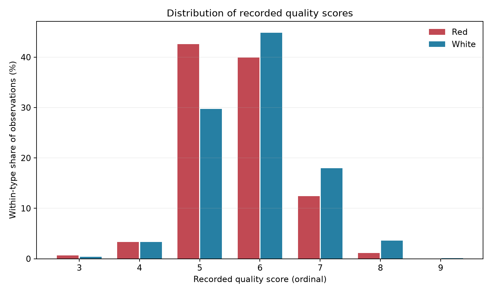
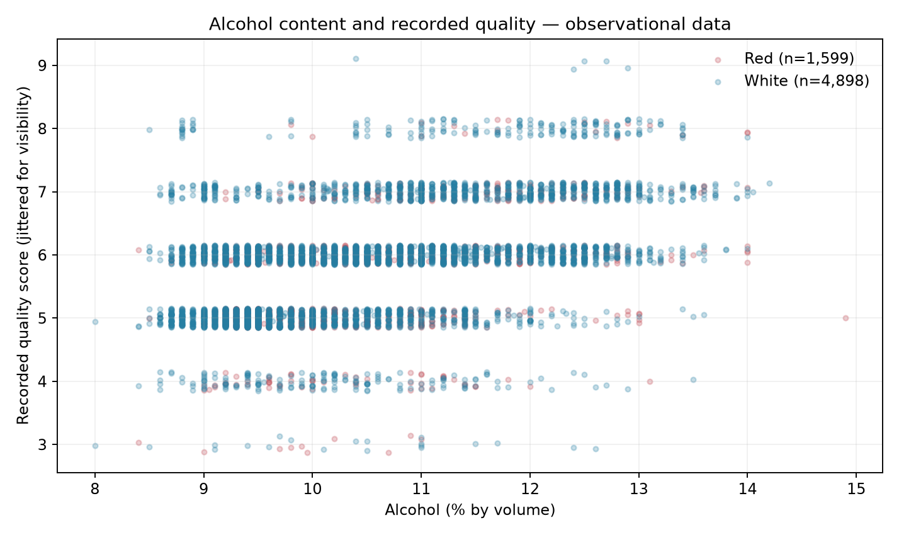
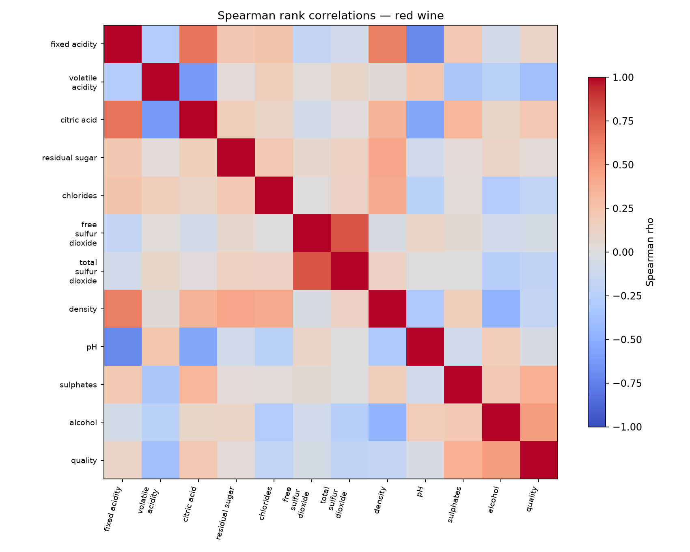
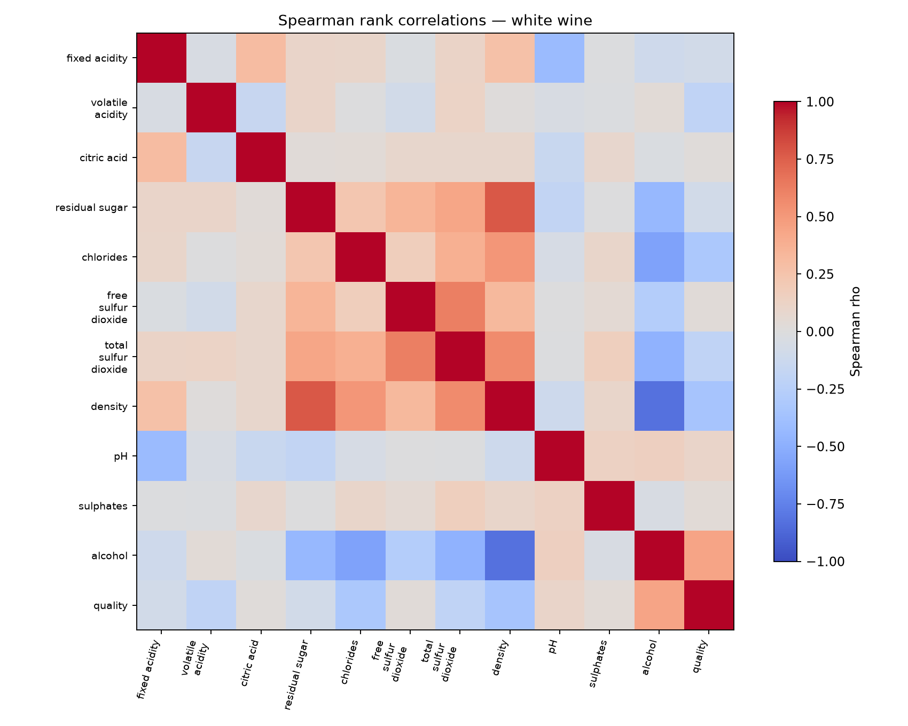

# Statistical Data Analysis & Visualization with Python

**An independent, reproducible data analysis portfolio project**  
**Antonio Carlos Fernández Castillo** · [LinkedIn](https://www.linkedin.com/in/antonio-fern%C3%A1ndez-4a943a375/) · [GitHub](https://github.com/tonyfdzc34-ops)

> **Project status:** Analyzed the original UCI Wine Quality data locally (6,497 records); six automated tests passed. This is an exploratory, observational analysis—not a prediction system or a causal study. The project is unrelated to any unpublished thesis work.

## Overview

This project examines how physicochemical measurements relate to **recorded sensory quality scores** in the public [UCI Wine Quality dataset](https://archive.ics.uci.edu/dataset/186/wine+quality). It demonstrates a complete workflow: public-data acquisition, quality checks, reproducible analysis, statistical visualization, multiple-testing correction, and careful communication of uncertainty.

**Tools:** Python · pandas · NumPy · SciPy · Matplotlib · pytest  
**Methods:** Exploratory data analysis · Spearman rank correlation · Benjamini–Hochberg FDR · Percentile bootstrap · Data quality auditing

## At a glance

| Dataset | Observations | Most frequent quality score | Share at that score | Spearman ρ: alcohol vs. quality |
|---|---:|---:|---:|---:|
| Red wine | 1,599 | 5 | 42.6% | +0.479 |
| White wine | 4,898 | 6 | 44.9% | +0.440 |
| **Total** | **6,497** | — | — | — |

**Key takeaways:**

- Alcohol content shows the strongest **positive monotonic association** with recorded quality among the analyzed physicochemical features in each wine type. This is an association, **not proof of causation**.
- Volatile acidity is negatively associated with quality (red: ρ = −0.381; white: ρ = −0.197).
- Density is negatively associated with quality (red: ρ = −0.177; white: ρ = −0.348).
- Multiple testing was accounted for with Benjamini–Hochberg FDR **within each wine type**. Nine of eleven feature–quality associations in each type have adjusted q-values below 0.05; statistical significance does not imply a large or practically important effect.
- No missing data cells were found. Exact duplicate rows and IQR outlier flags were **reported, not automatically discarded**.

For details, read the **[reviewed findings and limitations](docs/PORTFOLIO_FINDINGS_FINAL.md)** or the **[automatically generated report](outputs/REPORT.md)**.

## Visualizations

### Distribution of recorded quality scores

The percentages are calculated **within each wine type**, to account for different sample sizes.



### Alcohol content and quality

Vertical jitter helps show overlapping records on an ordinal score scale. It changes visualization only, **not the recorded values**.



### Spearman correlation matrices

**Red wine:**



**White wine:**



## Reproduce the analysis

Requires Python 3.10+ and an internet connection for the initial download. Run these commands **from the repository root**:

```bash
python -m pip install -r requirements.txt
python scripts/download_data.py
python -m src.analysis
python -m pytest -q
```

On Windows, you can replace `python` with the path to your own Python interpreter or virtual environment. No API keys or private datasets are needed.

The pipeline produces:

| Output | Purpose |
|---|---|
| [`outputs/REPORT.md`](outputs/REPORT.md) | Automated summary, confidence intervals, cautions |
| [`outputs/tables/data_quality_audit.csv`](outputs/tables/data_quality_audit.csv) | Missing values, identical rows, outlier flags |
| [`outputs/tables/quality_counts.csv`](outputs/tables/quality_counts.csv) | Quality-score frequencies by wine type |
| [`outputs/tables/quality_spearman_associations.csv`](outputs/tables/quality_spearman_associations.csv) | Correlation coefficients, p-values, adjusted q-values |
| [`outputs/figures/`](outputs/figures/) | Four generated figures |

See [docs/methodology.md](docs/methodology.md) for the methodological choices and [docs/PORTFOLIO_FINDINGS_FINAL.md](docs/PORTFOLIO_FINDINGS_FINAL.md) for a review of results and limitations.

## Interpretation and limitations

- The sensory quality score is **ordinal**; it is not a continuous laboratory measurement.
- Correlations are calculated **separately for red and white wines** and do not establish causal effects.
- Exact duplicates cannot be confirmed as data-entry errors without unique sample identifiers; IQR flags alone do not justify deleting observations.
- Bootstrap confidence intervals are exploratory and assume independent sampled rows, which cannot be guaranteed from the dataset metadata.
- The six passing tests verify aspects of the code's behavior, **not the validity of every scientific assumption**. No predictive accuracy or external validation is claimed.

## Data source and attribution

Cortez, P., Cerdeira, A., Almeida, F., Matos, T., & Reis, J. (2009). *Modeling wine preferences by data mining from physicochemical properties.* Decision Support Systems, 47(4), 547–553. [UCI Wine Quality dataset](https://doi.org/10.24432/C56S3T), licensed under [CC BY 4.0](https://creativecommons.org/licenses/by/4.0/). Original dataset authors retain attribution; the data are not the portfolio author's original research.

---

**Portfolio author:** Antonio Carlos Fernández Castillo · [Professional profile](https://www.linkedin.com/in/antonio-fern%C3%A1ndez-4a943a375/)
